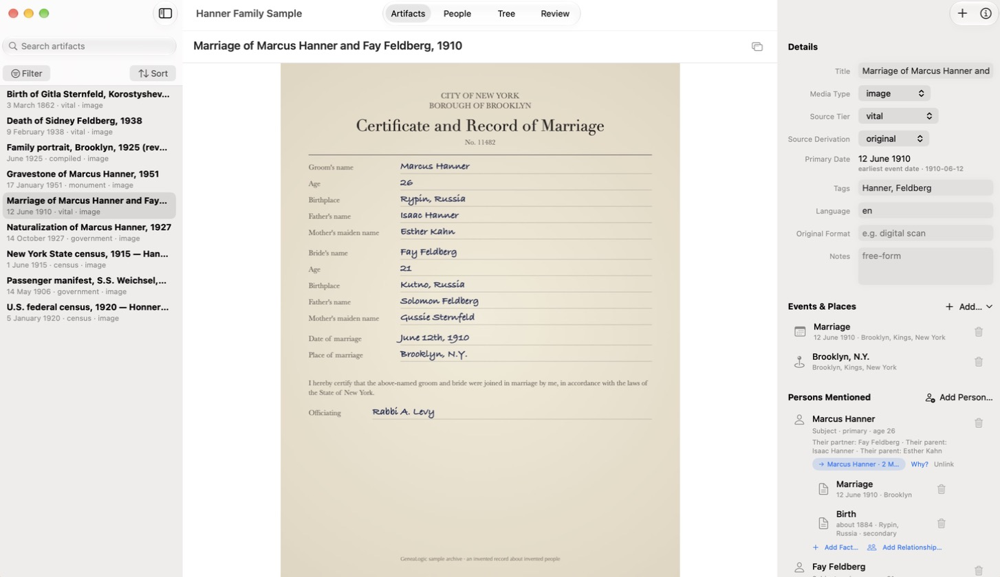
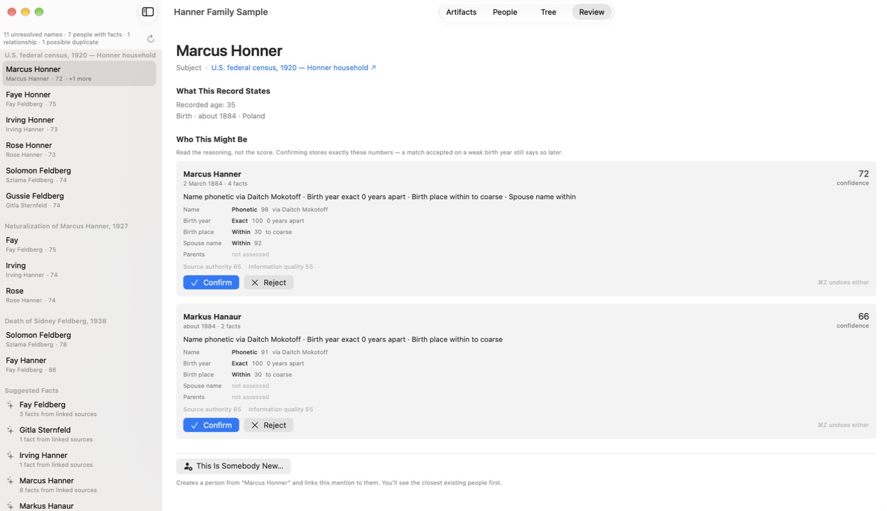
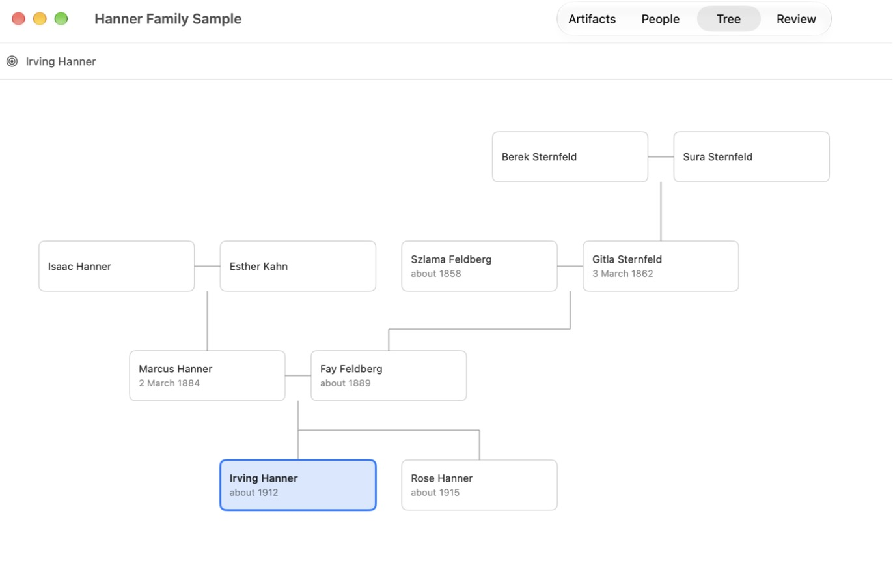

# GeneaLogic

Genealogy software in which **documents come first and the family tree is derived from
them.**

Most genealogy software has you enter a tree by hand and attach documents as an
afterthought. GeneaLogic starts from the archive of source documents and keeps two layers
apart:

- **Evidence** is what a document says: the census page, the names it records as written,
  the ages and places it gives.
- **Conclusions** are what you infer from the evidence: that this "Anna Meyer" is the
  same person as that one, and who her parents were.

The tree is computed from both, so it can always show which documents support a fact and
whether a person or a machine made the call. A matcher suggests which mentions belong to
which person and explains each score. Nothing is linked until you confirm it.







The family in these pictures is invented, and so are its records. The app builds the same
sample from its welcome screen, and `genea sample` builds it from the command line.

An archive is a plain folder of your files and their JSON records, with a copy of its
[format specification](GeneaLogicKit/schema/genealogic-archive-1.0.md) inside, so it
stays readable without this software. Everything in it is checksummed. The search index
is a cache that can be rebuilt from the files. Two writers, or two machines syncing one
archive through a file-sync service, are handled without losing data.

## Status

**Pre-`0.1`: nothing is released yet, so build from source.** While the version is `0.x`
there is **no stability promise** for GeneaLogicKit's Swift API, the `genea` CLI's
output, or the archive format, and any of them may change in any release. `1.0` is where
the format and CLI stability promise will be made. The app's version and the format's
version (`genealogic-archive-1.0`) are numbered separately.

Where the project is going is in the [roadmap](docs/ROADMAP.md).

## What's here

| Folder | What it is |
| --- | --- |
| [`GeneaLogicKit/`](GeneaLogicKit) | The engine: a Swift package with no UI or networking, which builds on macOS and Linux. Archives, records, integrity checks, the index, sync reconciliation, and the matcher. |
| [`GeneaLogicCLI/`](GeneaLogicCLI) | `genea`, a command-line front end to the engine ([reference](GeneaLogicCLI/README.md)). |
| [`GeneaLogicApp/`](GeneaLogicApp) | The SwiftUI Mac app. |
| [`docs/`](docs) | Architecture, roadmap, and the record of every slice of work. |

A Vapor server for publishing an archive to the web is planned, not yet built.

## Requirements

- **The Mac app:** macOS 26.5 and Xcode 26.5.
- **The engine and CLI:** Swift 6.3 on macOS 26, or on Linux.
- **Running the Linux tests on a Mac:** Apple's [`container`](https://github.com/apple/container).

## Build and test

```bash
swift test --package-path GeneaLogicKit      # the engine
swift test --package-path GeneaLogicCLI      # the CLI
scripts/linux-test.sh                        # the engine, in a swift:6.3 Linux container
```

The Mac app:

```bash
xcodebuild -project GeneaLogicApp/GeneaLogicApp.xcodeproj -scheme GeneaLogicApp \
  -derivedDataPath ~/Library/Developer/GeneaLogicApp-DD -destination 'platform=macOS' test
open ~/Library/Developer/GeneaLogicApp-DD/Build/Products/Debug/GeneaLogic.app
```

To get an archive to try it on, click **Explore a Sample Archive** on the welcome screen.
[CONTRIBUTING](CONTRIBUTING.md) explains the `-derivedDataPath` setting and covers the
rest of the workflow.

## Try the CLI

```bash
swift build --package-path GeneaLogicCLI
export PATH="$PWD/GeneaLogicCLI/.build/debug:$PATH"

genea create /tmp/Demo.genea --name "Family Research"

# Evidence: a document, and a name exactly as it appears in it.
ART=$(genea add /tmp/Demo.genea --title "1920 census, Ward 3" --media-type image --source-tier census)
REF=$(genea mention add /tmp/Demo.genea "$ART" --name "Anna Meyer" --role subject --age 28)

# A conclusion: a person, and the link that says the mention is her.
ANNA=$(genea person add /tmp/Demo.genea --given Anna --surname Meyer)
genea link /tmp/Demo.genea --artifact "$ART" --mention "$REF" --person "$ANNA"

genea person show /tmp/Demo.genea "$ANNA"
genea verify /tmp/Demo.genea

# Or start from the sample, an invented family with something left to review.
genea sample /tmp/Sample.genea
genea match suggest /tmp/Sample.genea --artifact "$(genea find /tmp/Sample.genea 1920 | cut -f1)"
```

`genea match suggest` proposes links instead of you making them by hand. The
[CLI reference](GeneaLogicCLI/README.md) has every command and a longer example.

## Use GeneaLogicKit

```swift
import Foundation
import GeneaLogicArchive
import GeneaLogicModel

let archive = try Archive.create(
    at: URL(filePath: "Research.genea"), name: "Family Research")

let census = try archive.addArtifact(
    ArtifactDraft(
        title: "1920 census, Ward 3",
        mediaType: .image,
        sourceAuthorityTier: .census,
        events: [Event(type: "Census", date: "1920-01-05", location: "Springfield")]
    ))
try archive.attachFile(
    copyingFrom: URL(filePath: "scans/census.tif"), to: census.uid, role: .preservationMaster)

for hit in archive.artifacts(matching: ArtifactQuery(text: "census")) {
    print(hit.uid, hit.title)  // ART-…  1920 census, Ward 3
}
```

To run it, put it in `Sources/TryKit/main.swift` of a package beside your clone, create a
file at `scans/census.tif` (any bytes will do), and `swift run`. The package's manifest:

```swift
// swift-tools-version: 6.3
import PackageDescription

let package = Package(
    name: "TryKit",
    platforms: [.macOS(.v26)],
    dependencies: [.package(path: "../GeneaLogic/GeneaLogicKit")],
    targets: [
        .executableTarget(
            name: "TryKit",
            dependencies: [
                .product(name: "GeneaLogicArchive", package: "GeneaLogicKit"),
                .product(name: "GeneaLogicModel", package: "GeneaLogicKit"),
            ])
    ]
)
```

The package's products are `GeneaLogicModel` (the record types), `GeneaLogicArchive`
(the engine), `GeneaLogicMatch` (the scorer), `GeneaLogicExtract` (embedded-metadata
extraction on Apple platforms) and `GeneaLogicSample` (the sample archive). It lives in a subfolder of this repository, so for now
it can only be a path dependency, as above. SwiftPM can depend by URL only on a package
whose manifest is at the root of its repository.

## Documentation

- [Architecture](docs/ARCHITECTURE.md): how it is designed, and why.
- [Archive format spec](GeneaLogicKit/schema/genealogic-archive-1.0.md): enough to read
  an archive without this software.
- [Roadmap](docs/ROADMAP.md): where it is going, and how a piece of work is specified.
- [Slices](docs/slices/README.md) and the [slice log](docs/SLICE-LOG.md): what each piece
  of work specified and decided.
- [CLI reference](GeneaLogicCLI/README.md).
- [Contributing](CONTRIBUTING.md) and [security](SECURITY.md).

## License

The code is licensed under the [Apache License 2.0](LICENSE). The archive format
specification is licensed under [CC BY 4.0](https://creativecommons.org/licenses/by/4.0/).
See [NOTICE](NOTICE).

**Your archive is yours.** The spec's license covers the spec only. The records and files
in an archive belong to whoever created them, and GeneaLogic claims no rights in them.

"GeneaLogic" is a trademark, and neither license grants rights in it. See the
[trademark policy](TRADEMARKS.md): in short, forks are welcome under their own name.
